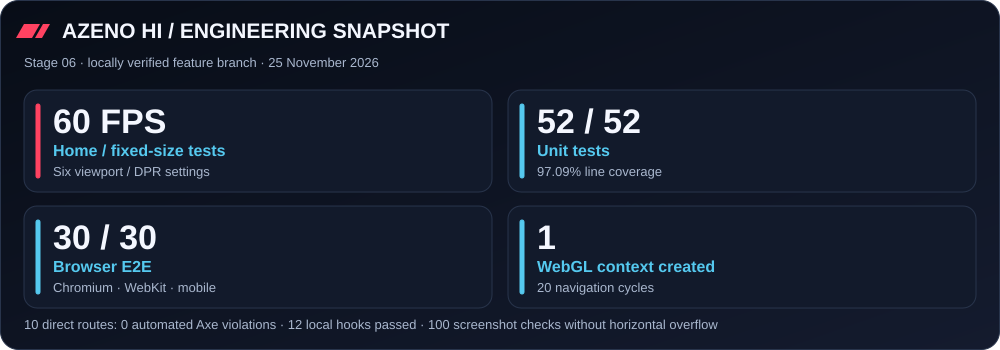
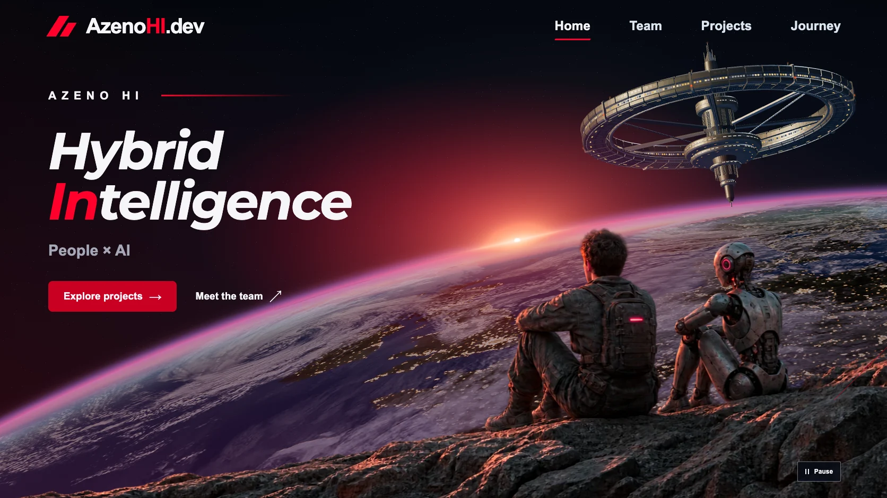
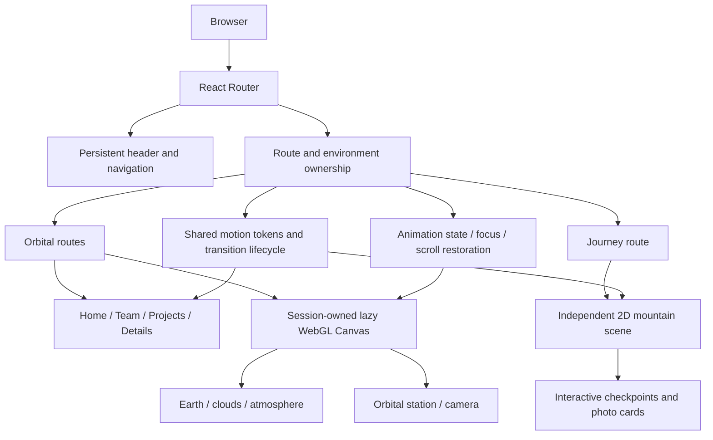
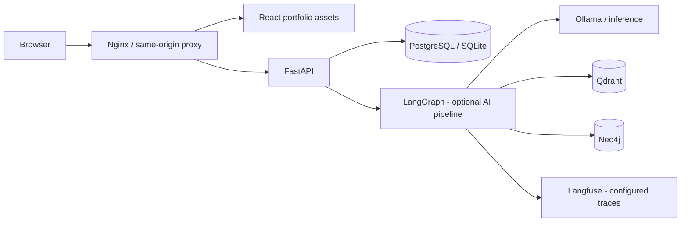
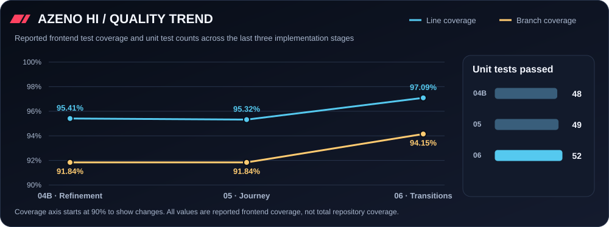
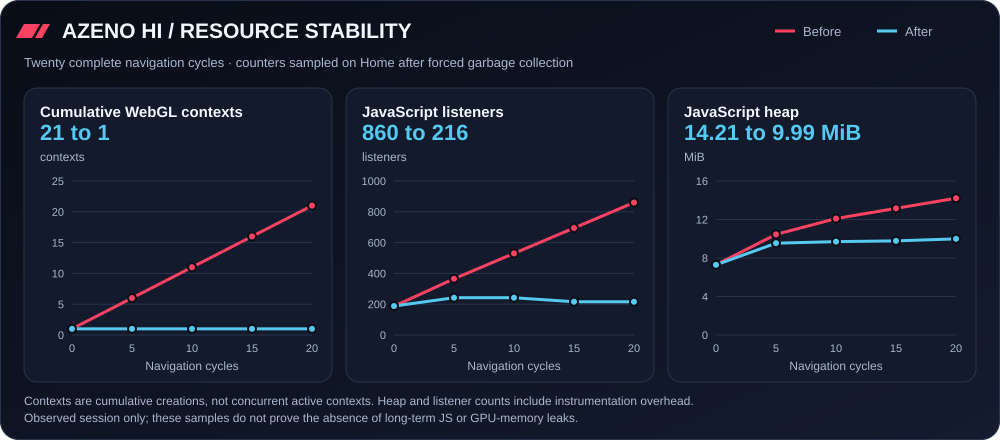
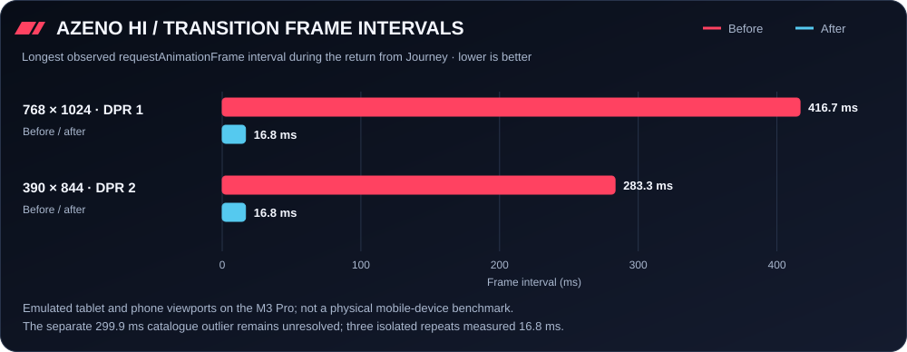
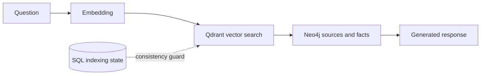
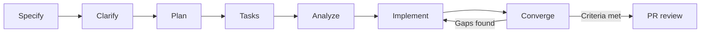

<div align="center">

# AZENO HI

### Hybrid Intelligence · People × AI

**A cinematic technology portfolio, built around people, projects and the journey from ideas to real impact.**

[Repository](https://github.com/stuntsxlc4/azenohi_dev) · [Development workflow](docs/spec-driven.md) · [Technical documentation](docs/versions.md)

</div>



> **Development status — 25 November 2026:** Stages 01–06 are implemented. Stage 06 passed local verification and was merged into `main` in [PR #8](https://github.com/stuntsxlc4/azenohi_dev/pull/8). Public deployment is pending verification. Team profiles, selected project content, achievements and Journey entries remain demonstration material until approved for publication.

## Contents

- [Project overview](#project-overview)
- [Experience and features](#experience-and-features)
- [Technology stack](#technology-stack)
- [Architecture](#architecture)
- [Design and motion system](#design-and-motion-system)
- [Engineering results](#engineering-results)
- [Development history](#development-history)
- [Getting started](#getting-started)
- [Quality and testing](#quality-and-testing)
- [AI and backend foundation](#ai-and-backend-foundation)
- [Spec-driven development](#spec-driven-development)
- [Production readiness](#production-readiness)
- [Repository structure](#repository-structure)
- [Documentation and evidence](#documentation-and-evidence)

## Project overview

AZENO HI is a technology team portfolio rather than a conventional administrative dashboard. Its visual identity combines a real-time orbital environment, a project showcase and a mountain-based narrative representing the team's growth.

The core idea is **one connected experience**. Earth and the orbital station continue their motion as visitors explore the team and its projects. Journey introduces an independent mountain environment, while the application preserves the orbital scene's state for the return trip.

The project is built on a fork of the [Risk Engine application starter](https://github.com/pawelkonior/risk-engine). The inherited full-stack and AI infrastructure remains available for future integration; the portfolio's visual experience does not require an LLM or a database to render its core content.



*Existing Home preview from the repository. It predates the final Stage 06 transition audit; it is not presented as a new final-build screenshot.*

## Experience and features

### 01 — Home: Hybrid Intelligence

- Real-time, textured 3D Earth with surface detail, clouds, atmosphere and lighting.
- Animated orbital station, including its rotating ring and independent movement.
- Cinematic camera framing, layered foreground and controlled parallax.
- Header navigation to Team, Projects and Journey.
- Pause/Play, reduced-motion support and a fallback for unavailable WebGL.

### 02 — Team: People × AI

- Responsive gallery of 12 illustrative team members, with individually styled portraits.
- Typed profile data separated from presentation components.
- Roles and technology icons for areas including Python, JavaScript, TypeScript, React, AI, cloud, data engineering and DevOps.
- Rounded portrait cards, coordinated blue/red lighting and subtle hover feedback.
- Continuous orbital background; changing route does not reset Earth or the station.
- Desktop composition refined to fit two rows at the audited 1920 × 1080 viewport, with natural scrolling on smaller screens.

### 03 — Projects: From Hackathons to Real Impact

The catalogue uses a shared card system, six individual concept illustrations, event metadata, achievement labels where supplied, and reusable project-detail layouts. Every project has a directly addressable page.

| Project | Focus | Reference event | Reference achievement |
| --- | --- | --- | --- |
| **CapTrace** | AI risk copilot for FRTB-SA capital explainability | HSBC AI Risk Hackathon | 1st Place |
| **Done** | Voice-first shopping assistant with AI agents | Start Warsaw × OpenAI | 3rd Place |
| **PrivyMeet** | Privacy-first meeting assistant | SWM × Google DeepMind | 3rd Place |
| **Productivity Suite** | AI toolkit for Treasury operations | HSBC Global Finals | Europe 1st |
| **RiskTrace Control Tower** | RWA modernization and risk analytics platform | IBM Bob Hackathon | — |
| **Risk Miner** | AI for public investment risk | HackNation | — |

> These descriptions, event names and awards are taken from the supplied design materials. They are portfolio content under review, not independently verified competition results, client relationships or performance claims.

**Standard project detail** — a reusable layout for CapTrace, Done, PrivyMeet, Productivity Suite and RiskTrace Control Tower, combining project summary, event, optional achievement, concept artwork and return navigation.

**Extended case study** — Risk Miner adds the four capabilities *Detect, Predict, Analyse, Support*, a Poland-themed hero illustration, conceptual product gallery, technology stack and project-team section. The illustrated technology labels include Python, FastAPI, Kubernetes and Google Cloud; these do not establish the actual deployed stack of Risk Miner. Demonstration data and gallery concepts are not live risk measurements.

### 04 — Journey: Small Steps. Big Dreams.

Journey uses an independently rendered mountain panorama rather than another WebGL scene. A glowing red route leads through five interactive checkpoints towards a summit carrying the AZENO HI flag.

| Milestone | Illustrative story |
| --- | --- |
| 2017 | It all started at my place |
| 2018 | Remote work during Zoom era |
| 2020 | First hackathons and real impact |
| 2023 | Growing team, bigger goals |
| 2025 | More projects, more impact |

The desktop timeline aligns its entries with the terrain. Tablet and phone layouts retain the hero and present a vertical sequence of interactive entries. The five photo cards and the mountain background total approximately 230 KB in the Stage 05 report. The supplied Journey concept was edited with ImageGen to produce a clean background plate; the five photo frames were cropped from the supplied concept. These are illustrative materials, not verified historical photographs or dates.

### 05 — Cinematic transitions

Stage 06 joins the orbital and mountain environments into a unified navigation experience:

- A persistent header and a session-owned orbital Canvas.
- Route-specific camera interpolation, content entry/exit and artwork transitions.
- A 900 ms environment transition using a live crossfade and warm horizon light.
- Preservation of orbital geometry, rotation phases, textures and Pause/Play choice after returning from Journey.
- No unnecessary WebGL drawing while Journey fully covers the orbital environment.
- Keyboard focus and scroll-position restoration, including return to the originating project card.
- Cancellable transitions and support for reduced motion.

### Routes

| Route | Experience |
| --- | --- |
| `/` | Hybrid Intelligence / Home |
| `/team` | People × AI |
| `/projects` | Project catalogue |
| `/projects/captrace` | CapTrace detail |
| `/projects/done` | Done detail |
| `/projects/privymeet` | PrivyMeet detail |
| `/projects/productivity-suite` | Productivity Suite detail |
| `/projects/risktrace-control-tower` | RiskTrace Control Tower detail |
| `/projects/risk-miner` | Extended Risk Miner case study |
| `/journey` | Mountain timeline |

All ten routes are included in the Stage 06 accessibility and visual verification scope.

## Technology stack

### Portfolio application

| Layer | Technologies | Responsibility |
| --- | --- | --- |
| UI | React, TypeScript | Component-based pages and typed content models |
| Build | Vite, npm | Development server and production bundling |
| Routing | React Router | Client-side navigation, direct routes and history |
| 3D rendering | Three.js, React Three Fiber, WebGL | Earth, clouds, atmosphere, orbital station and camera |
| Supporting 3D utilities | three-stdlib | Supporting graphics functionality in the orbital bundle |
| Motion and styling | CSS, semantic design/motion tokens | Responsive layout, transitions, gradients and microinteractions |
| 2D graphics | Local optimized image assets, SVG / Devicon where available | Journey, portraits, project concept art and technology icons |
| Unit testing | Vitest | Component and animation/state verification |
| Browser testing | Playwright, Axe | Navigation, rendering, accessibility and regression checks |
| Code quality | Strict TypeScript, type-aware linting, Prettier | Local frontend quality gates |

### Inherited application and AI foundation

The repository retains the starter's backend and AI capabilities. These are available for future features, **not required services for the portfolio animation itself**.

| Layer | Technologies |
| --- | --- |
| API | Python, FastAPI, Uvicorn, OpenAPI |
| Database and migrations | PostgreSQL, SQLite, Alembic |
| AI orchestration | LangGraph |
| Local inference | Ollama; configured models `qwen3:0.6b` and `embeddinggemma` |
| Knowledge and retrieval | Neo4j, Qdrant |
| AI observability | Langfuse; separate PostgreSQL, ClickHouse, Redis and RustFS in the local stack |
| Python quality | uv, Ruff, strict Pyright, pytest, Sphinx |
| Infrastructure | Docker Compose, Nginx, Makefile, pre-commit |
| Deployment configuration | Vercel frontend and FastAPI backend templates; external managed services |
| Agent tooling | Codex, Spec Kit, project skills and Playwright CLI |

**Toolchain pins documented by the existing starter:** Node 26.13.1, npm 12.2.2, Python 3.14.10, Spec Kit 1.4.1, Docker Compose ≥ 2.23.1. Follow the repository's lockfiles, `.nvmrc`, `api/.python-version` and [version documentation](docs/versions.md) as the source of truth.

## Architecture

### Portfolio runtime



The orbital Canvas is lazy-loaded. Direct entry to `/journey` does not create WebGL. Once warmed, the renderer and its resources survive navigation to Journey; after the transition the covered scene stops drawing. Returning to an orbital route reuses the existing scene and restores its state.

### Scene lifecycle

| Environment / state | Rendering behavior |
| --- | --- |
| Active orbital view | Continuous animation and damped camera framing |
| Paused orbital view | Demand rendering; a route change requests a finite reframe |
| Crossing environments | Live transition between orbital content and Journey |
| Fully covered orbital scene | React Three Fiber `never` frame loop; no steady-state draw calls observed |
| Hidden document | Frame loop suspended |
| Direct Journey entry | No orbital renderer construction |

The animation clock excludes time spent fully covered. Rotation and cloud-shadow phases are preserved rather than reset on a route change. Outgoing content becomes inert and is hidden from accessibility APIs immediately, even when still visible briefly during the fade. The design deliberately trades retained GPU allocations for fast return to the orbital environment.

### Full-stack foundation



The local Compose stack uses PostgreSQL; SQLite is an alternative for local API development. LangGraph, Ollama, Neo4j, Qdrant and Langfuse belong to the retained starter infrastructure. This diagram describes the available full-stack foundation, not a claim that the portfolio uses all these services on every page.

## Design and motion system

The visual language combines deep-space navy, saturated red brand accents, cold blue lighting and warm sunrise reflections. A shared semantic palette, page gutters, card geometry, typography and motion tokens keep the orbital pages and Journey recognizably part of the same brand.

| Design area | Implementation direction |
| --- | --- |
| Branding | AzenoHI.dev wordmark, red diagonal accent, active navigation underline |
| Typography | Large cinematic headings, italic emphasis, readable supporting text |
| Cards | Rounded corners, controlled artwork masks, local gradients and consistent footers |
| Team | Near-square portrait composition, technology accents and clear name panels |
| Projects | Three-column desktop grid, wide 1.9:1 cards and individual project artwork |
| Journey | Mountain panorama, glowing route, summit flag and responsive milestones |
| Motion | Shared durations/easing, camera damping, reversible content transitions and restrained hover effects |
| Accessibility | Reduced motion, keyboard controls, visible focus, semantic HTML and WebGL fallback |

The design priority is **stability → a stable 30 FPS minimum target → cinematic quality → visual detail → adaptation for weaker hardware**. The desktop target is smooth 60 FPS, with higher cadence where the display and runtime allow it. The accepted visual assets were preserved through the final polish instead of being regenerated unnecessarily.

## Engineering results

All numerical results below are from the user-supplied implementation reports for Stages 04B, 05 and 06. Stage 06 compares the production baseline `5e48ff8` with the feature branch `codex/cinematic-transitions`. These are recorded local verification results, not live CI badges or an independent external audit.

### 1. Test coverage and quality progression



| Stage | Unit tests passed | Line coverage | Branch coverage |
| --- | ---: | ---: | ---: |
| 04B — Visual Refinement | 48 | 95.41% | 91.84% |
| 05 — Journey | 49 | 95.32% | 91.84% |
| **06 — Cinematic Transitions** | **52** | **97.09%** | **94.15%** |

### 2. WebGL and memory stability



Each build completed twenty cycles of **Home → Team → Projects → CapTrace → Projects → Risk Miner → Journey → Home**. Counters were sampled on Home after forced garbage collection.

| Cycle | Context creations before → after | JS listeners before → after | JS heap before → after (MiB) |
| ---: | ---: | ---: | ---: |
| 0 | 1 → 1 | 187 → 188 | 7.30 → 7.29 |
| 5 | 6 → 1 | 365 → 242 | 10.45 → 9.54 |
| 10 | 11 → 1 | 530 → 242 | 12.10 → 9.70 |
| 15 | 16 → 1 | 695 → 216 | 13.16 → 9.78 |
| **20** | **21 → 1** | **860 → 216** | **14.21 → 9.99** |

At the twentieth checkpoint, cumulative context creations were **95.2% lower**, listener counts **74.9% lower**, and the sampled JS heap **29.7% lower** than the baseline. The after-build retained one Canvas, recorded no context-loss events and made zero draw calls in the fully covered Journey steady-state samples. All six instrumented WebGL resource types matched their initial allocation-minus-deletion counts at cycle 20.

These counters include instrumentation/framework overhead; they do not measure total driver memory. The twenty-cycle observation does not establish the absence of long-term JavaScript or GPU memory leaks.

### 3. Rendering throughput and transition smoothness



| CSS viewport | DPR | Home WebGL FPS before → after | Home P99 before → after (ms) | Longest return RAF interval before → after (ms) |
| --- | ---: | ---: | ---: | ---: |
| 2560 × 1440 | 1 | 60.0 → 60.0 | 16.8 → 16.8 | 16.7 → 16.8 |
| 1920 × 1080 | 1 | 60.0 → 60.0 | 16.8 → 16.8 | 16.7 → 16.8 |
| 1440 × 900 | 1 | 60.0 → 60.0 | 16.8 → 16.8 | 16.8 → 16.8 |
| 1440 × 900 | 2 | 60.0 → 60.0 | 16.8 → 16.8 | 16.7 → 16.8 |
| 768 × 1024 | 1 | 60.0 → 60.0 | 16.8 → 16.8 | **416.7 → 16.8** |
| 390 × 844 | 2 | 60.0 → 60.0 | 16.8 → 16.8 | **283.3 → 16.8** |

**Measurement environment:** MacBook Pro M3 Pro (18 GB), Chrome 158.0.8127.38, ANGLE Metal renderer. Each fixed viewport/DPR configuration used a fresh page, eight seconds of initial warm-up and three 1.4-second steady-state samples; transitions used three 1.45-second windows per direction. The table uses median-of-three Home FPS, largest Home P99 and longest return RAF interval. These are browser-emulated viewports, not tests on physical mobile devices.

WebGL FPS counts distinct animation frames issuing draw calls. RAF counts browser callbacks. Neither represents measured monitor scanout or exact GPU execution time. One separate tablet catalogue sample contained a **299.9 ms** interval; three isolated repeats measured 16.8 ms, and the original cause remains unresolved.

### 4. Native Retina observations

The built-in display reported 3456 × 2234 physical pixels. Additional headed Chrome runs observed approximately 120 WebGL draw-cadence FPS both before and after.

| Observation | Before | After |
| --- | ---: | ---: |
| Browser viewport (CSS pixels) | 1728 × 996 | 1200 × 864 |
| DPR | 2 | 2 |
| Drawing-buffer width | 3456 px | 2400 px |
| Median observed Journey readiness | 9.5 ms | 8.4 ms |
| Median observed Home readiness | 1767.0 ms | 7.9 ms |

Readiness is measured to the first RAF observation of the destination landscape element or renderer-ready flag, **not** to complete image decoding or a presented frame. Chrome used different window sizes, so this is not a controlled like-for-like speedup benchmark. Use the fixed-size matrix above for direct throughput comparisons.

### 5. Bundle and asset efficiency

| Production artifact | Baseline | Stage 06 |
| --- | ---: | ---: |
| Main JavaScript | 289.15 kB | 291.38 kB |
| Main JavaScript (gzip) | 92.08 kB | 92.86 kB |
| CSS | 30.14 kB | 35.55 kB |
| Lazy orbital chunk | 1,064.99 kB | 1,065.13 kB |
| Lazy orbital chunk (gzip) | 290.00 kB | 290.08 kB |

Journey's six optimized assets totaled approximately 230 KB at Stage 05. The orbital chunk remains above the existing 500 kB build-warning threshold; its size is driven substantially by Three.js and React Three packages. The final lifecycle optimization improves return behavior without claiming a smaller orbital bundle. Direct Journey entry avoids constructing the renderer.

### 6. Final verification snapshot

| Quality gate | Stage 06 result |
| --- | --- |
| Frontend lint, formatting, strict types and production build | Passed |
| Unit tests | 52 / 52 passed |
| Frontend line coverage | 97.09% |
| Frontend branch coverage | 94.15% |
| Selected browser E2E scenarios | 30 / 30 passed |
| E2E engines | Chromium, WebKit, mobile Chromium — 10 each |
| Local pre-commit hooks | 12 / 12 passed |
| Backend checks and documentation | Passed |
| Compose configuration and Spec Kit checks | Passed |
| Automated Axe checks | 0 violations across 10 direct routes with reduced motion |
| Visual matrix | 100 route/size combinations, no horizontal overflow |
| Production matrix console / page errors | 0 reported |
| Firefox | Not verified in Stage 06; previous launch issue remains open |

The Stage 06 report also records a **48.91-second, 1920 × 1080 H.264 cinematic tour**, containing 2,797 decoded frames and averaging 57.2 captured frames/s. Capture cadence is independent of application throughput. Watch the [cinematic tour](specs/004-cinematic-transitions/cinematic-tour.mp4) or see the [verification report](specs/004-cinematic-transitions/verification.md) for the screenshot matrix and raw measurements.

## Development history

| Stage | Delivered scope | Status |
| --- | --- | --- |
| 01 — Design System | Shared visual identity, typography, palette, layout and navigation | Implemented |
| 02 — Earth Engine | Animated 3D Earth, atmosphere, clouds, station, quality and motion controls | Implemented |
| 03 — Team & Shared Scene | Team portraits, technology icons, routing and persistent orbital composition | Implemented |
| 04 — Projects & Case Studies | Six project cards, six detail routes, extended Risk Miner case study | Implemented |
| 04B — Cinematic Visual Refinement | Card proportions, composition, artwork integration, responsive and visual audit | Implemented / reported verified |
| 05 — Journey | Mountain scene, five checkpoints, optimized artwork, responsive timeline | Implemented / merged in baseline `5e48ff8` |
| 06 — Cinematic Transitions & Final Polish | Scene lifecycle, motion, memory stability, accessibility and performance audit | Verified locally and merged in `6631c75` |
| 07 — Production Content | Replace demonstration profiles, history, awards, links and project material | Planned |
| 08 — Production Readiness & Deployment | Hosting, domain, metadata, production configuration and live verification | Planned |

## Getting started

### Option A — Docker Compose (full application stack)

Requires Git, Make and a running Docker installation with Compose 2.23.1 or newer.

```bash
git clone https://github.com/stuntsxlc4/azenohi_dev.git
cd azenohi_dev
make up
```

The default Compose environment exposes its development services on localhost. Use the root `.env.example` as the basis for local configuration where needed. The initial startup downloads the configured Ollama models and initializes the required databases, migrations, constraints and vector collection; network access is needed for the first model download.

| URL | Service |
| --- | --- |
| http://127.0.0.1:8080 | Portfolio frontend |
| http://127.0.0.1:8000/docs | FastAPI Swagger UI |
| http://127.0.0.1:8000/health/ready | API and database readiness |
| http://127.0.0.1:8080/health/web | Frontend server readiness |
| http://127.0.0.1:3000 | Langfuse |
| http://127.0.0.1:7474 | Neo4j Browser |
| http://127.0.0.1:6333/dashboard | Qdrant dashboard |

```bash
make logs
make down
```

`make down` retains named volumes. **Do not use `docker compose down -v` unless you intend to delete local database data and downloaded models.** Local ports and credentials are configured through the environment; never expose development credentials publicly. When a host Ollama installation already uses port 11434, the starter supports an alternative `OLLAMA_PORT` in the root `.env`.

### Option B — Local development

Use the pinned Node/npm and Python/uv toolchain described in [docs/versions.md](docs/versions.md). Install `nvm` and `uv` before running the commands below.

```bash
nvm install
nvm use
npm install --global npm@12.2.2 --no-audit --no-fund
make install
make hooks
```

Start the API using its local SQLite configuration:

```bash
cd api
uv run alembic upgrade head
uv run uvicorn app.main:app --reload
```

In another terminal, from the repository root:

```bash
npm --prefix web run dev
```

The standalone Vite frontend uses http://localhost:5173; the Compose entry point is http://localhost:8080. Vite proxies API traffic to the local backend. Consult [web/README.md](web/README.md) and [api/README.md](api/README.md) for environment overrides and detailed setup. The portfolio's core visual content can be rendered without the AI services.

<a id="sprawdzenia-lokalne-i-pre-commit"></a>

## Quality and testing

The starter uses local quality gates rather than GitHub Actions. The existing coverage thresholds are at least 90% across the documented coverage dimensions; no thresholds were reduced for Stage 06.

```bash
make check
make web-check
make api-check
make compose-check
make spec-check
make e2e
```

Manual pre-commit verification:

```bash
uv run --project api --locked pre-commit run --all-files
```

The default E2E mode starts a production-preview frontend (port 4173) and an isolated API (port 8001) using a temporary SQLite database, then cleans up its processes and test data. The default suite includes Firefox, so a full `make e2e` run may still encounter the known Firefox launch issue. Stage 06's 30 passed scenarios refer to the three selected browser projects, not the complete Firefox-inclusive matrix.

To test a separately running Compose test environment:

```bash
PLAYWRIGHT_BASE_URL=http://127.0.0.1:8080 npm --prefix web run test:e2e:compose
```

Use a separate test environment for browser tests that create or modify API records. Browser reports are written to `web/playwright-report`; failed-test evidence is written to `web/test-results`.

Verified behavior includes direct routes and reloads, browser history, active navigation, keyboard focus, originating-card restoration, reduced motion, checkpoint selection, interrupted transitions, phase preservation, hidden frame-loop behavior, responsive layouts and automated Axe checks. Automated accessibility checks do not substitute for real assistive-technology testing.

## AI and backend foundation

The inherited starter provides a sample CRUD API and optional AI document ingestion and retrieval.

| Endpoint | Purpose |
| --- | --- |
| `PUT /api/v1/ai/documents/{uuid}` | Index a document with optional explicit facts and evidence citations |
| `POST /api/v1/ai/query` | Run the LangGraph retrieval and response pipeline |



The SQL registry tracks indexing state to protect retrieval against partial writes. Outside Compose, AI is disabled by default and can be enabled with `APP_AI_ENABLED=true` when correctly configured.

```bash
make ai-init
make ai-smoke
make langfuse-smoke
```

Langfuse captures configured AI operation traces, normally metadata and timings without prompt/response content. Content capture is opt-in. The starter disables the documented default telemetry integrations and retains JSON logs and request identifiers. These are inherited configuration choices, not a completed production security audit.

Read [AI architecture](docs/ai.md) and [Langfuse configuration and privacy](docs/langfuse.md) before enabling AI features or sending real data. The existence of a backend does not imply that the portfolio itself is an AI-powered runtime service.

## Spec-driven development

AZENO HI follows the repository's Codex and Spec Kit workflow. Requirements, clarification decisions, implementation plans and tasks precede implementation. Convergence links requirements to code, tests, measurements and visual evidence.



| Skill | Purpose |
| --- | --- |
| `$speckit-specify`, `$speckit-clarify` | Capture requirements, constraints and decisions |
| `$speckit-plan`, `$speckit-tasks` | Architecture, execution plan and traceable work items |
| `$speckit-analyze` | Identify requirement/plan/task inconsistencies |
| `$speckit-implement` | Implement the agreed tasks and verify behavior |
| `$speckit-converge` | Reconcile the delivered evidence and identify gaps |
| `$vercel-react-best-practices` | React rendering, effects and frontend performance guidance |
| `$playwright-cli` | Verify the running application, capture screenshots and inspect interactions |

```bash
make spec-install
make spec-check
make agent-install
make agent-check
```

Project-specific skills and configuration live under `.agents/`, `.codex/` and `.specify/`. Follow [AGENTS.md](AGENTS.md), the [Spec Kit workflow guide](docs/spec-driven.md) and the [agent tooling guide](docs/agent-tooling.md). The Stage 06 convergence process identified and corrected overlapping accessibility headings, inefficient paused-camera interpolation and lingering foreground copy during the crossfade.

## Production readiness

The cinematic implementation is complete within the locally verified Stage 06 scope. That is different from a fully published, production-validated portfolio.

### Remaining work

- **Content approval:** replace illustrative people, portraits, dates, events, awards and product screenshots with approved information; verify asset rights and organizer marks before publication.
- **Production deployment:** select the actual hosting target and domain, configure HTTPS, production environment variables, cache behavior, security headers, health monitoring and live smoke tests.
- **Discoverability:** finalize titles and descriptions, Open Graph imagery, favicon, canonical URLs, sitemap and indexing policy.
- **Real-device accessibility:** verify physical mobile hardware, assistive technology and battery/GPU behavior.
- **Browser follow-up:** Firefox's previously recorded `Could not find profile folder` launch problem remains open and is outside Stage 06.
- **Technical debt:** investigate the isolated tablet frame outlier if reproducible; evaluate the Three.Clock deprecation warning and large lazy orbital chunk without compromising scene quality or return behavior.

### Deployment foundation

The starter includes separate Vercel configurations for `web` (Vite, `dist`) and `api` (FastAPI). Frontend builds can receive the public API address in `VITE_API_BASE_URL`. Backend deployment requires a production PostgreSQL configuration and appropriate CORS origins; the starter documents `APP_ENVIRONMENT=production` and disabling public API docs with `APP_DOCS_ENABLED=false`.

Run production migrations as an explicit controlled step. Do not put credentials in `VITE_*` variables because they are compiled into browser code. The inherited AI configuration uses external inference, graph, vector and tracing services when deployed outside Compose. Authentication and authorization must be designed for the actual application if protected API capabilities are exposed.

See [web/README.md](web/README.md), [api/README.md](api/README.md), [AI deployment notes](docs/ai.md) and [api/.env.vercel.example](api/.env.vercel.example). Vercel configuration exists, but no live production environment is claimed by this README.

## Repository structure

```text
azenohi_dev/
├── .agents/              Project skills and agent tooling
├── .codex/               Codex project configuration
├── .specify/             Spec Kit constitution and workflow configuration
├── api/                  FastAPI, migrations, AI modules and Python checks
│   └── src/app/
│       ├── modules/ai/    AI contracts, ingest, orchestration and SQL registry
│       └── platform/ai/   Ollama/chat, Neo4j and Qdrant adapters
├── web/
│   ├── src/
│   │   ├── app/          App composition and shared layout
│   │   ├── features/     Portfolio features and inherited application modules
│   │   └── shared/       Shared components and API client
│   ├── public/           Local graphic and media assets
│   │   └── journey/      Optimized mountain panorama and photo cards
│   └── e2e/              Playwright scenarios
├── specs/                Feature specifications, plans and tasks
├── docs/                 Architecture, tooling and verification documentation
│   └── readme/           README charts and transcribed benchmark data
├── AGENTS.md             Project instructions for coding agents
├── compose.yaml          Local service orchestration
├── Makefile              Development and quality commands
└── README.md
```

This is a high-level directory map, not an exhaustive list of every file.

## Documentation and evidence

| Resource | Purpose |
| --- | --- |
| [AGENTS.md](AGENTS.md) | Repository development instructions |
| [Spec-driven development](docs/spec-driven.md) | Spec Kit workflow |
| [Agent tooling](docs/agent-tooling.md) | Codex skills and supporting tools |
| [Toolchain versions](docs/versions.md) | Runtime and tooling compatibility |
| [Web documentation](web/README.md) | Frontend setup and testing |
| [API documentation](api/README.md) | Backend configuration and operations |
| [AI documentation](docs/ai.md) | AI pipeline, data stores and deployment |
| [Langfuse documentation](docs/langfuse.md) | Tracing and privacy settings |
| [Starter verification](docs/verification.md) | Inherited infrastructure verification |
| [Stage 06 verification report](specs/004-cinematic-transitions/verification.md) | Final polish, test results and known limitations |
| [Benchmark summary data](docs/readme/benchmark-data.json) | Values used to render the README graphs; not the original raw measurement logs |

The [Stage 06 evidence directory](specs/004-cinematic-transitions/evidence/) contains the before-and-after screenshots, raw performance and memory samples, accessibility results and test output.

---

<div align="center">

**AZENO HI — Small Steps. Big Dreams.**

*From people and ideas to real impact.*

</div>
